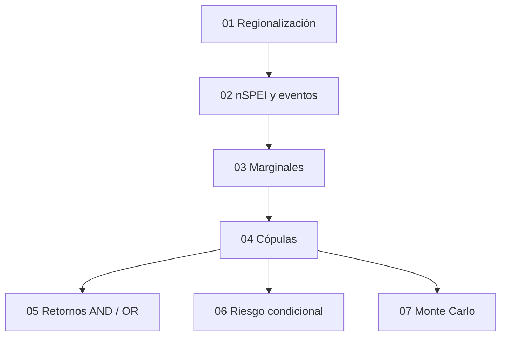

# Predicción probabilística de sequías en el sur del Perú

Repositorio reproducible de la tesis:

> **Predicción probabilística de sequías en el sur del Perú mediante modelos de cópulas y datos hidrometeorológicos**

El proyecto implementa un flujo completo para caracterizar sequías meteorológicas, regionalizar estaciones, identificar eventos, ajustar distribuciones marginales, modelar la dependencia duración–severidad mediante cópulas, estimar periodos de retorno conjuntos y riesgo condicional, y generar escenarios sintéticos mediante simulación Monte Carlo.

---

## Estado de reproducibilidad

**Auditoría estructural aprobada**

```text
Archivos obligatorios: 45
Presentes: 45
Faltantes: 0
Resultado: AUDITORÍA ESTRUCTURAL APROBADA
```

La auditoría automática se encuentra en:

```text
04_documentacion/reproducibilidad/verificar_reproducibilidad.R
```

y genera:

```text
AUDITORIA_ARCHIVOS.csv
AUDITORIA_INVENTARIO_RESULTADOS.csv
AUDITORIA_RESUMEN.txt
```

> La auditoría estructural verifica existencia y organización de archivos. La reproducibilidad numérica fue comprobada durante la validación individual de los bloques analíticos.

---

## Objetivo general

Desarrollar un modelo probabilístico de predicción de sequías basado en modelos de cópulas y datos hidrometeorológicos en la Región Sur del Perú.

---

## Objetivos específicos y trazabilidad analítica

La investigación contiene **ocho objetivos específicos**. La implementación reproducible actual se organiza en **siete bloques analíticos**, porque el bloque `02_nspei_eventos` cubre simultáneamente la caracterización multiescala del nSPEI y la identificación/caracterización de eventos.

| OE | Objetivo analítico | Bloque reproducible |
|---:|---|---|
| 1 | Caracterizar la variabilidad temporal y la ocurrencia de sequías mediante nSPEI-3, nSPEI-6 y nSPEI-12 | `02_nspei_eventos` |
| 2 | Establecer una regionalización hidroclimática mediante clustering | `01_regionalizacion` |
| 3 | Identificar y caracterizar eventos de sequía y evaluar la suficiencia muestral | `02_nspei_eventos` |
| 4 | Determinar la escala temporal y ajustar distribuciones marginales de duración y severidad | `03_marginales` |
| 5 | Modelar la dependencia bivariada duración–severidad mediante familias de cópulas | `04_copulas` |
| 6 | Estimar periodos de retorno conjuntos bajo criterios AND y OR | `05_periodos_retorno` |
| 7 | Analizar el riesgo condicional ante excedencias críticas de duración o severidad | `06_riesgo_condicional` |
| 8 | Generar escenarios probabilísticos mediante simulación Monte Carlo | `07_montecarlo` |

La numeración de bloques responde al flujo computacional reproducible y no implica que deba existir una correspondencia obligatoria de un notebook por objetivo.

---

## Datos y ámbito del estudio

- **Fuente principal:** estaciones meteorológicas del SENAMHI.
- **Ámbito:** Región Sur del Perú.
- **Periodo:** 1970–2023.
- **Número de estaciones:** 28.
- **Escalas nSPEI:** 3, 6 y 12 meses.
- **Atributos principales de eventos:** duración, severidad, intensidad y mínimo nSPEI.
- **Escala seleccionada para el modelamiento probabilístico bivariado:** nSPEI-3.

Antes de publicar datos crudos en un repositorio público, debe verificarse que su redistribución sea compatible con las condiciones de uso de la fuente original.

---

## Estructura del repositorio

```text
TESIS_SEQUIAS_UNCP_GITHUB
├── 01_datos
│   ├── raw
│   ├── intermedios
│   ├── procesados
│   └── metadata
├── 02_scripts
│   ├── 01_regionalizacion
│   ├── 02_nspei_eventos
│   ├── 03_marginales
│   ├── 04_copulas
│   ├── 05_periodos_retorno
│   ├── 06_riesgo_condicional
│   └── 07_montecarlo
├── 03_resultados
│   ├── 01_regionalizacion
│   │   ├── tablas
│   │   └── figuras
│   ├── 02_nspei_eventos
│   │   ├── tablas
│   │   └── figuras
│   ├── 03_marginales
│   │   ├── tablas
│   │   └── figuras
│   ├── 04_copulas
│   │   ├── tablas
│   │   └── figuras
│   ├── 05_periodos_retorno
│   │   ├── tablas
│   │   └── figuras
│   ├── 06_riesgo_condicional
│   │   ├── tablas
│   │   └── figuras
│   └── 07_montecarlo
│       ├── tablas
│       └── figuras
├── 04_documentacion
│   ├── metodologia
│   ├── diccionario_datos
│   └── reproducibilidad
├── 05_anexos_tesis
│   ├── codigos
│   ├── tablas
│   └── figuras
├── README.md
├── LICENSE
└── .gitignore
```

---

## Flujo computacional



En términos de dependencia de archivos:

```text
Base hidrometeorológica
        ↓
Regionalización + nSPEI multiescala
        ↓
eventos_nspei_todas_escalas.csv
        ↓
Marginales
        ↓
Cópulas
        ↓
┌────────────────────┬─────────────────────┬────────────────────┐
│ Retornos AND / OR  │ Riesgo condicional  │ Monte Carlo        │
└────────────────────┴─────────────────────┴────────────────────┘
```

---

## Requisitos

### Software recomendado

- **R 4.5.2**
- **Jupyter Notebook / JupyterLab**
- **IRkernel** para ejecutar notebooks R

Los notebooks cargan sus dependencias mediante `pacman` cuando corresponde.

Entre los paquetes utilizados se encuentran:

```r
tidyverse
janitor
lmomco
copula
zoo
patchwork
metR
plotly
htmlwidgets
```

Algunos bloques pueden utilizar paquetes adicionales especificados dentro de cada notebook.

---

## Ejecución

### 1. Clonar o copiar el repositorio

En Windows, la estructura validada utiliza como raíz:

```text
<RAIZ_REPOSITORIO>
```

Los notebooks finales fueron adaptados a esta raíz para la reproducción local de la tesis.

### 2. Ejecutar en orden

Ejecutar los notebooks principales desde una sesión limpia:

```text
02_scripts/01_regionalizacion/01_analisis_cluster_estaciones.ipynb

02_scripts/02_nspei_eventos/
02_nspei_eventos_por_estacion_y_cluster.ipynb

02_scripts/03_marginales/
03_ajuste_marginales_nspei3.ipynb

02_scripts/04_copulas/
04_ajuste_copulas_nspei3.ipynb

02_scripts/05_periodos_retorno/
05_periodos_retorno_and_or_nspei3.ipynb

02_scripts/06_riesgo_condicional/
06_riesgo_condicional_nspei3.ipynb

02_scripts/07_montecarlo/
07_prediccion_montecarlo_nspei3.ipynb
```

### 3. Ejecutar la auditoría final

Desde PowerShell:

```powershell
& "C:\Program Files\R\R-4.5.2\bin\Rscript.exe" `
"<RAIZ_REPOSITORIO>\04_documentacion\reproducibilidad\verificar_reproducibilidad.R"
```

Resultado esperado:

```text
Total obligatorio: 45
Presentes: 45
Faltantes: 0

RESULTADO: AUDITORÍA ESTRUCTURAL APROBADA
```

---

# Descripción de los bloques

## 01 — Regionalización hidroclimática

Notebook:

```text
02_scripts/01_regionalizacion/01_analisis_cluster_estaciones.ipynb
```

Entrada principal:

```text
01_datos/raw/Base_Datos_Final_ETo_Pivot.csv
```

El bloque regionaliza las 28 estaciones a partir de variables hidroclimáticas y altitudinales mediante distancia euclidiana y agrupamiento jerárquico Ward.D2, complementado con criterios de validación.

### Resultado principal

Se identificaron **tres clusters hidroclimáticos**:

| Cluster | Estaciones |
|---:|---:|
| 1 | 18 |
| 2 | 6 |
| 3 | 4 |

Los archivos con sufijo `_ORIGINAL` se conservan como evidencia histórica y no forman parte del flujo normal de ejecución.

---

## 02 — nSPEI multiescala y eventos de sequía

Notebook:

```text
02_scripts/02_nspei_eventos/02_nspei_eventos_por_estacion_y_cluster.ipynb
```

Salida crítica:

```text
01_datos/procesados/eventos_nspei_todas_escalas.csv
```

El índice no paramétrico se calcula para escalas de 3, 6 y 12 meses. Posteriormente se identifican eventos y se obtienen duración, severidad, intensidad y mínimo nSPEI.

### Eventos reproducidos

| Escala | Cluster 1 | Cluster 2 | Cluster 3 | Total |
|---|---:|---:|---:|---:|
| nSPEI-3 | 584 | 152 | 61 | **797** |
| nSPEI-6 | 377 | 97 | 33 | **507** |
| nSPEI-12 | 188 | 49 | 15 | **252** |

Total multiescala:

```text
1556 eventos
```

### Nota metodológica importante

El algoritmo recuperado define una racha como meses consecutivos con:

```r
nSPEI < 0
```

y conserva la racha como evento si al menos un valor alcanza:

```r
nSPEI <= -1
```

Este comportamiento corresponde al código histórico efectivamente utilizado y debe distinguirse de los umbrales empleados posteriormente para clasificación o visualización.

---

## 03 — Distribuciones marginales

Notebook:

```text
02_scripts/03_marginales/03_ajuste_marginales_nspei3.ipynb
```

Se comparan las siguientes familias:

**Duración**

```text
WEI, PE3, LN3, GAM
```

**Severidad**

```text
PE3, GPA, LN3, GAM
```

La estimación de parámetros reproducida utiliza **momentos-L** mediante `lmomco`.

### Modelos seleccionados

| Cluster | Duración | Severidad |
|---:|---|---|
| 1 | WEI | PE3 |
| 2 | WEI | PE3 |
| 3 | PE3 | PE3 |

Salidas principales:

```text
03_resultados/03_marginales/tablas/
```

---

## 04 — Dependencia bivariada mediante cópulas

Notebook:

```text
02_scripts/04_copulas/04_ajuste_copulas_nspei3.ipynb
```

Familias candidatas:

```text
Clayton
Frank
Gumbel
Gaussian
t-Student
```

La selección se realiza a partir de log-verosimilitud, AIC y BIC.

### Cópula seleccionada

**Gumbel** fue seleccionada en los tres clusters.

| Cluster | θ | logLik | AIC | BIC |
|---:|---:|---:|---:|---:|
| 1 | 2.8444 | 505.6839 | -1009.3677 | -1004.9978 |
| 2 | 2.8306 | 146.5150 | -291.0300 | -288.0061 |
| 3 | 3.3715 | 86.8668 | -171.7336 | -169.6227 |

Los parámetros se obtienen automáticamente mediante `fitCopula()`.

Salidas:

```text
03_resultados/04_copulas/tablas/
03_resultados/04_copulas/figuras/
```

---

## 05 — Periodos de retorno conjuntos AND y OR

Notebook:

```text
02_scripts/05_periodos_retorno/05_periodos_retorno_and_or_nspei3.ipynb
```

Se emplean:

\[
P_{AND}=P(D>d,S>s)=1-u-v+C(u,v)
\]

\[
P_{OR}=P(D>d\cup S>s)=1-C(u,v)
\]

y:

\[
T_{AND}=\frac{1}{\lambda P_{AND}}
\]

\[
T_{OR}=\frac{1}{\lambda P_{OR}}
\]

donde:

\[
\lambda=\frac{N_{\text{eventos}}}{54}
\]

### Control P90–P90

| Cluster | T_AND | T_OR |
|---:|---:|---:|
| 1 | 1.077 | 0.637 |
| 2 | 4.605 | 2.678 |
| 3 | 9.585 | 5.512 |

Los parámetros de Gumbel se leen desde los resultados del Bloque 04.

---

## 06 — Riesgo condicional

Notebook:

```text
02_scripts/06_riesgo_condicional/06_riesgo_condicional_nspei3.ipynb
```

Se calculan:

\[
P(D>d\mid S>s)
\]

y:

\[
P(S>s\mid D>d)
\]

a partir de la probabilidad conjunta de excedencia.

### Escenarios representativos P90–P90

| Cluster | P(D>d \| S>s) | P(S>s \| D>d) |
|---:|---:|---:|
| 1 | 0.72124 | 0.76766 |
| 2 | 0.79108 | 0.68694 |
| 3 | 0.60871 | 0.91232 |

El sentido de las probabilidades es importante:

```text
P(D>d | S>s) → duración condicionada por severidad
P(S>s | D>d) → severidad condicionada por duración
```

---

## 07 — Simulación Monte Carlo

Notebook:

```text
02_scripts/07_montecarlo/07_prediccion_montecarlo_nspei3.ipynb
```

Configuración:

```text
20 000 simulaciones por cluster
60 000 escenarios sintéticos en total

Semilla cluster 1: 101
Semilla cluster 2: 102
Semilla cluster 3: 103
```

Las parejas dependientes se generan mediante la cópula de Gumbel y posteriormente se transforman al espacio de duración y severidad utilizando las marginales ajustadas por momentos-L.

### Medias simuladas de control

| Cluster | Duración media | Severidad media |
|---:|---:|---:|
| 1 | 6.8562 | 6.6550 |
| 2 | 9.0413 | 8.7010 |
| 3 | 16.2723 | 15.0329 |

El bloque produce además:

- probabilidades de excedencia respecto a P50, P75 y P90;
- clasificación de escenarios en **Típico**, **Severo** y **Extremo**;
- densidades predictivas;
- nube sintética duración–severidad.

---

## Productos reproducibles

Los productos finales se guardan exclusivamente en:

```text
03_resultados/
```

Cada bloque dispone de:

```text
tablas/
figuras/
```

Los notebooks finales están diseñados para:

1. calcular los resultados;
2. mostrarlos dentro del notebook;
3. guardar automáticamente las tablas;
4. guardar automáticamente las figuras.

---

## Convenciones de archivos

### `_ORIGINAL`

Indica una copia preservada del archivo histórico recuperado.

Ejemplo:

```text
04_ajuste_copulas_nspei3_ORIGINAL.ipynb
```

No debe modificarse.

### Notebook sin sufijo

Es la versión reproducible y limpia:

```text
04_ajuste_copulas_nspei3.ipynb
```

Es la versión que debe ejecutarse.

### Numeración editorial

La numeración de tablas y figuras puede variar entre versiones de edición de la tesis. La trazabilidad científica debe basarse primero en:

1. contenido;
2. variable analizada;
3. archivo generado;
4. valores reproducidos;

y luego en el número editorial de tabla o figura.

---

## Reproducibilidad y preservación

Durante la reconstrucción se distinguieron tres tipos de material:

```text
1. código histórico original;
2. evidencia histórica de resultados;
3. versión reproducible final.
```

La versión reproducible no modifica los resultados para hacerlos coincidir artificialmente con la tesis. Cuando se identificó una discrepancia entre código histórico y descripción textual, esta se documentó en lugar de alterar el algoritmo.

---

## Auditoría automática

Archivo:

```text
04_documentacion/reproducibilidad/verificar_reproducibilidad.R
```

Ejecución:

```powershell
& "C:\Program Files\R\R-4.5.2\bin\Rscript.exe" `
"<RAIZ_REPOSITORIO>\04_documentacion\reproducibilidad\verificar_reproducibilidad.R"
```

Último resultado validado:

```text
COMUN                       2/2 presentes
01_regionalizacion          1/1 presentes
02_nspei_eventos            1/1 presentes
03_marginales               6/6 presentes
04_copulas                 11/11 presentes
05_periodos_retorno         7/7 presentes
06_riesgo_condicional       8/8 presentes
07_montecarlo               9/9 presentes

Total obligatorio: 45
Presentes: 45
Faltantes: 0

RESULTADO: AUDITORÍA ESTRUCTURAL APROBADA
```

---

## Documentación adicional

```text
04_documentacion/reproducibilidad/
```

contiene:

```text
AUDITORIA_FINAL_REPRODUCIBILIDAD.md
AUDITORIA_ARCHIVOS.csv
AUDITORIA_INVENTARIO_RESULTADOS.csv
AUDITORIA_RESUMEN.txt
verificar_reproducibilidad.R
```

También pueden conservarse en esta carpeta archivos de auditoría forense y extracción de celdas históricas. Estos últimos no son necesarios para ejecutar el pipeline principal.

---

## Recomendaciones para reproducción

Para una reproducción estricta:

1. iniciar una sesión nueva de R;
2. ejecutar los notebooks en el orden indicado;
3. no reutilizar objetos de sesiones anteriores;
4. no modificar las semillas Monte Carlo;
5. no introducir parámetros θ manualmente;
6. conservar las familias marginales seleccionadas según el ajuste reproducido;
7. ejecutar la auditoría final al terminar.

---

## Citación del repositorio

Mientras no exista una versión publicada con DOI, puede citarse de forma provisional como:

```text
Arriaga Gómez, V. Predicción probabilística de sequías en el sur del Perú
mediante modelos de cópulas y datos hidrometeorológicos.
Repositorio reproducible de tesis.
```

Cuando el repositorio sea publicado formalmente, se recomienda completar esta sección con:

- URL permanente del repositorio;
- versión o release;
- fecha de publicación;
- DOI, si se deposita en Zenodo u otro repositorio;
- referencia definitiva de la tesis.

---

## Licencia

Consulte el archivo:

```text
LICENSE
```

para conocer las condiciones de uso del código y materiales incluidos en el repositorio.

Las condiciones de redistribución de datos externos deben respetar las licencias o términos de las fuentes originales.

---

## Autor

**Virgilio Arriaga Gómez**

Proyecto desarrollado en el marco de una investigación de posgrado sobre modelamiento probabilístico de sequías en el sur del Perú.

---

## Estado del proyecto

```text
[✓] Regionalización hidroclimática
[✓] nSPEI multiescala
[✓] Identificación de eventos
[✓] Distribuciones marginales
[✓] Cópulas
[✓] Periodos de retorno AND/OR
[✓] Riesgo condicional
[✓] Simulación Monte Carlo
[✓] Auditoría estructural
[ ] Publicación final del repositorio
```
